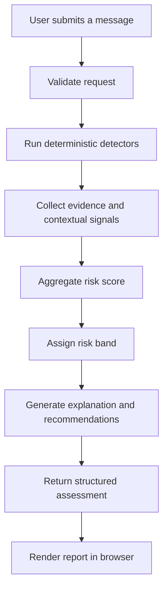
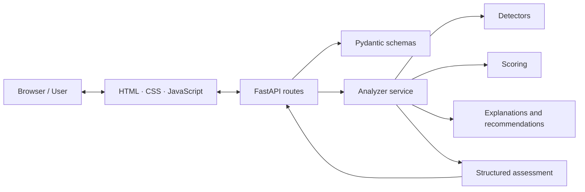

<div align="center">

# TrustLens AI

### Think before you trust.

**Explainable scam-risk assessment for suspicious internship offers, scholarships, job postings, URLs, and forwarded messages.**

[](https://www.python.org/)
[](https://fastapi.tiangolo.com/)
[](https://pytest.org/)
[](#project-status)

[Overview](#overview) · [Features](#features) · [Architecture](#architecture) · [Quick Start](#quick-start) · [API](#api-reference) · [Testing](#testing) · [Security](#privacy-security-and-limitations)

</div>

---

## Overview

Students can be targeted by fake internships, fraudulent scholarships, impersonated recruiters, and messages designed to steal money or credentials. Common warning signs include upfront fees, artificial urgency, suspicious links, and requests for one-time passwords (OTPs).

**TrustLens AI** is a local-first cybersecurity triage application. It evaluates submitted text with a deterministic, rule-based engine, assigns an interpretable risk score from **0–100**, shows the evidence behind the assessment, and recommends practical next steps.

> [!IMPORTANT]
> TrustLens is a decision-support tool, not a definitive fraud detector. A low score does not prove authenticity. Verify opportunities through official channels before sending money, sharing documents, or disclosing credentials.

## At a glance

| | |
|---|---|
| **Purpose** | Explain warning signs in potentially fraudulent messages |
| **Analysis method** | Deterministic rules and contextual pattern detection |
| **Risk output** | Score, risk band, findings, evidence, and recommendations |
| **Backend** | Python, FastAPI, Pydantic |
| **Frontend** | HTML, CSS, vanilla JavaScript |
| **Persistence** | No database is part of the baseline design; recent reports are held in browser memory |
| **External API keys** | Not required for baseline analysis |

## Features

### Explainable detection
- Detects patterns associated with financial manipulation, urgency, sensitive-information requests, suspicious URLs, and employment or scholarship red flags.
- Produces findings with rule identifiers, severity, matched evidence, explanations, and recommended actions.
- Uses weighted scoring, diminishing returns, multi-indicator escalation, and duplicate-evidence suppression.
- Applies contextual safeguards for negation and educational messages—for example, “never share your OTP.”
- Identifies positive hygiene signals as context, without treating them as proof that an offer is genuine.

### Purpose-built interface
- **Landing page (`#home`)** introduces the product, threat categories, workflow, and privacy principles.
- **Analyzer workspace (`#analyzer`)** presents the message input, risk gauge, evidence, and next steps.
- Hash-based navigation supports deep links, refresh persistence, and browser Back/Forward navigation.
- Responsive dark interface with an educational “How It Works” view.

### Practical workflow
- Keeps up to five recent structured assessments in JavaScript memory.
- Allows a prior report to be revisited without submitting the original message again.
- Does not retain the original message in recent-analysis history.
- Supports copying an assessment report in Markdown format.
- Uses safe DOM APIs such as `textContent` when rendering untrusted text.

## How It Works



1. **Submit:** Paste a suspicious message into the analyzer.
2. **Validate:** The API checks the request against its input schema and limits.
3. **Detect:** Rule-based detectors look for known warning patterns and relevant context.
4. **Score:** The scoring service combines signals into a bounded score.
5. **Explain:** The response includes findings, evidence, severity, and recommended actions.
6. **Review:** Use the result as a prompt for independent verification—not as the final authority.

## Risk Score Guide

| Score | Risk level | Suggested response |
|---:|---|---|
| **0–19** | Low | Few explicit indicators were detected. Continue to use normal caution. |
| **20–44** | Moderate | Review the message carefully and verify unusual details. |
| **45–69** | High | Independently verify the sender and offer before proceeding. |
| **70–100** | Critical | Do not pay, share credentials, or act on the message until it has been independently verified. |

The score is a heuristic summary of detected patterns. It is not a probability that a message is fraudulent.

### Detector families

| Prefix | Focus |
|---|---|
| `FIN` | Financial manipulation, including upfront fees or deposits |
| `URG` | Urgency and pressure tactics |
| `SENS` | Sensitive information and credential requests |
| `URL` | Suspicious URL indicators |
| `EMP` | Employment and scholarship red flags |

The exact findings depend on the rules implemented and the submitted text.

## Architecture

TrustLens separates the API, analysis services, and browser interface.



### Repository layout

```text
TrustLens/
├── backend/
│   ├── app/
│   │   ├── main.py                 # FastAPI application entry point
│   │   ├── config.py               # Application settings
│   │   ├── schemas.py              # Request and response models
│   │   ├── api/
│   │   │   └── routes.py           # Health and analysis endpoints
│   │   └── services/
│   │       ├── analyzer.py         # Analysis orchestration
│   │       ├── detectors.py        # Rule and context detection
│   │       ├── scoring.py          # Risk-score aggregation
│   │       └── explanations.py     # Findings and recommendations
│   ├── tests/
│   │   ├── test_health.py
│   │   ├── test_validation.py
│   │   └── test_analysis.py
│   └── requirements.txt
├── frontend/
│   ├── index.html
│   ├── styles.css
│   └── app.js
├── .gitignore
└── README.md
```

## Technology Stack

| Component | Technology |
|---|---|
| Language | Python |
| API framework | FastAPI |
| Data validation | Pydantic |
| ASGI server | Uvicorn |
| Detection | Deterministic rules, regular expressions, contextual safeguards |
| User interface | HTML5, CSS, vanilla JavaScript |
| Tests | pytest |

The baseline implementation does not require a hosted AI service or external API key.

## Quick Start

### Prerequisites

- Python 3.12 or newer, compatible with the installed dependencies
- Windows, macOS, or Linux
- A modern browser
- Git, if cloning the repository

### 1. Get the source

If you have not cloned the repository yet:

```bash
git clone https://github.com/andhony07/TrustLens.git
cd TrustLens
```

If the project is already on your machine, navigate to the project root instead.

### 2. Create and activate a virtual environment

**Windows PowerShell**

```powershell
python -m venv .venv
.\.venv\Scripts\Activate.ps1
```

If script activation is blocked, use Command Prompt:

```bat
.venv\Scripts\activate.bat
```

**macOS / Linux**

```bash
python3 -m venv .venv
source .venv/bin/activate
```

### 3. Install dependencies

```bash
python -m pip install --upgrade pip
python -m pip install -r backend/requirements.txt
```

### 4. Start the application

Run from the repository root:

```bash
uvicorn app.main:app --app-dir backend --host 127.0.0.1 --port 8000 --reload
```

Open the local application:

| Resource | Address |
|---|---|
| Web interface | http://127.0.0.1:8000/ |
| Health check | http://127.0.0.1:8000/api/health |
| Interactive API docs | http://127.0.0.1:8000/api/docs |

**If port `8000` is unavailable**, run on port `8081`:

```bash
uvicorn app.main:app --app-dir backend --host 127.0.0.1 --port 8081 --reload
```

Then use the equivalent URLs with port `8081`.

### Optional: run the frontend separately

For local decoupled development, run the backend in one terminal:

```bash
uvicorn app.main:app --app-dir backend --host 127.0.0.1 --port 8000
```

In a second terminal:

```bash
python -m http.server 3000 --directory frontend
```

Visit http://127.0.0.1:3000/. Confirm that the frontend API base URL and backend CORS settings match your local setup.

## API Reference

Interactive API documentation is available at `/api/docs` while the server is running.

### `GET /api/health`

Checks whether the service is responding.

```bash
curl http://127.0.0.1:8000/api/health
```

A successful response includes service status, application name, analyzer version, and a timestamp.

### `POST /api/analyze`

Submits text for risk assessment.

**Example request**

```bash
curl -X POST "http://127.0.0.1:8000/api/analyze" \
  -H "Content-Type: application/json" \
  -d '{
    "text": "You have been selected for an internship. Pay a refundable registration deposit today to secure your position.",
    "input_type": "job_offer",
    "language_hint": "en"
  }'
```

**Illustrative response**

```json
{
  "analysis_id": "example-analysis-id",
  "input_type": "job_offer",
  "character_count": 100,
  "word_count": 17,
  "risk_score": 79,
  "risk_level": "Critical",
  "verdict_summary": "Critical scam indicators identified.",
  "findings": [
    {
      "rule_id": "FIN-01",
      "title": "Mandatory Upfront Fee or Deposit Demand",
      "category": "Financial Manipulation",
      "severity": "critical",
      "matched_evidence": ["registration deposit"],
      "explanation": "An upfront payment demand is a serious warning sign.",
      "recommended_action": "Do not transfer money; verify the offer independently."
    }
  ],
  "positive_signals": [],
  "recommended_actions": [
    "Do not send money before independently verifying the offer."
  ],
  "analyzer_method": "heuristic_rule_engine",
  "disclaimer": "Heuristic assessment, not a definitive fraud determination."
}
```

This is an illustrative response shape, not a guaranteed output for every message. Scores, findings, timestamps, and wording depend on the actual input and implemented rules. Refer to the running Swagger documentation for the current API contract.

## Testing

Activate the virtual environment, then run from the repository root:

```bash
python -m pytest backend/tests -v
```

The project documentation records a test run with **16 passed and 5 warnings**. Re-run the tests against your current checkout to verify its present state.

The documented suite covers:

- Health and API documentation endpoints
- Empty, whitespace-only, oversized, malformed, and unexpected-type inputs
- Upfront-fee, OTP, urgency, and suspicious-URL indicators
- Contextual negation and legitimate-message cases
- Duplicate-evidence suppression
- Score bounds, risk-band consistency, and response schema

Warnings in a previous run should be reviewed separately; a passing test suite does not mean warnings have been resolved.

## Privacy, Security, and Limitations

### Data handling

The baseline design processes submitted text through the local backend and does not intentionally persist message bodies to a database or forward them to third-party analysis services. Recent-analysis history is held in browser memory and is limited to structured reports; the original text is not retained in that history.

These statements describe the baseline design. Verify the actual configuration before making guarantees about a hosted deployment.

### Security considerations

- Do not submit passwords, live OTPs, private keys, or other secrets.
- Do not expose a development server directly to the public internet without a security review.
- Before deployment, review authentication, rate limiting, request limits, CORS, logging, transport security, and hosting configuration.
- Safe DOM rendering helps reduce XSS risk but is not a substitute for a broader security assessment.

### Known limitations

- **Heuristic, not forensic:** scores are based on implemented patterns and are not legal or forensic proof.
- **False positives and negatives:** legitimate messages can contain suspicious language, while sophisticated scams may evade current rules.
- **No baseline external threat intelligence:** the baseline engine does not query external DNS, malware, or domain-reputation feeds.
- **Positive signals are not proof:** a familiar-looking domain, reassuring wording, or a low score cannot establish authenticity.
- **Independent verification is essential:** use contact details from an organization's known official website or ask your institution's placement/career office. Do not rely solely on details supplied in the suspicious message.

## AI-Assisted Development Disclosure

The project author’s recorded disclosure identifies **Antigravity AI Coding Assistant (Gemini 3.8 Flash High)** as a development aid. Implementation was reviewed and debugged against the project’s automated tests and local API behavior.

Keep this disclosure accurate as tools and contributions change, and follow the event organizers' current attribution requirements.

## Project Status

TrustLens AI includes a FastAPI backend, browser-based analyzer, deterministic scoring, explanatory findings, and an automated test suite. The commands in this README are intended for local development; run the tests and inspect the API docs against your current checkout before relying on a particular version.

## Contributing

For proposed changes:

1. Create a focused branch.
2. Make a small, reviewable change.
3. Run the automated test suite.
4. Update documentation when behavior or API contracts change.
5. Open a pull request describing the motivation, implementation, and verification performed.
6. 
---

<div align="center">

**Pause. Inspect the evidence. Verify through official channels.**

</div>
